# Unit Test Agent - User Workflow (Step-by-Step Guide)

**What You'll Do:** Approve test plans, review generated tests, check results  
**What Takes Time:** Mostly automated; you decide at 3 key gates  
**Total Time:** ~2-3 hours per class (varies with complexity)

---

## � Complete Workflow Diagram (All Steps)

```mermaid
flowchart TD
    Start([User Triggers:<br/>/unit-test-agent ClassName]) --> P0A["<b>PHASE 0: Setup</b><br/>Load framework rules<br/>Take snapshot SHA-256<br/>Create run directory"]
    
    P0A --> P1["<b>PHASE 1: Analysis</b><br/>Read class & methods<br/>Check existing tests<br/>Measure baseline coverage<br/>Print summary to user"]
    
    P1 --> P2UserDecision{"<b>STOP POINT #1</b><br/>USER: Which class?<br/><br/>Read options<br/>Make decision"}
    
    P2UserDecision -->|User picks class| P2A["<b>PHASE 2: Class Selected</b><br/>Lock in class name<br/>Log user decision"]
    P2UserDecision -->|User says STOP| Wrap["Go to Wrap-up<br/>Phase 9"]
    
    P2A --> P3["<b>PHASE 3: Plan Design</b><br/>Analyze class methods<br/>Design test cases<br/>Identify collaborators<br/>Create plan.md file<br/>Print plan summary"]
    
    P3 --> P4UserDecision{"<b>STOP POINT #2</b><br/>USER: Approve Plan?<br/><br/>Read test cases<br/>Make decision"}
    
    P4UserDecision -->|APPROVE| P4A["<b>PHASE 4: Record Approval</b><br/>Compute SHA-256 hash<br/>Write approval record<br/>Log to audit.log"]
    P4UserDecision -->|REVISE| P3
    P4UserDecision -->|SKIP| P9["Go to Next Class<br/>Phase 9"]
    
    P4A --> P5["<b>PHASE 5: Generate Tests</b><br/>Write Java test code<br/>All case IDs present<br/>Create test file<br/>Print code preview"]
    
    P5 --> P6A["<b>PHASE 6: Quality Check</b><br/>Run guard check<br/>Validate assertions<br/>Check naming<br/>No hardcoded secrets<br/>No PowerMock"]
    
    P6A --> P6AResult{Guard Check<br/>Result?}
    P6AResult -->|✓ PASS| P6B["<b>PHASE 6B: Compilation</b><br/>Run mvn test-compile<br/>Verify syntax"]
    P6AResult -->|✗ FAIL| P6Fix["Show errors to user<br/>Fix quality issues<br/>Retry up to 3x"]
    P6Fix --> P6AResult
    
    P6B --> P6BResult{Compilation<br/>Result?}
    P6BResult -->|✓ PASS| P6C["<b>PHASE 6C: First Test Run</b><br/>Run mvn test<br/>Collect results<br/>Record outcomes"]
    P6BResult -->|✗ FAIL| P6CompFix["Show compilation error<br/>Fix code<br/>Retry up to 3x"]
    P6CompFix --> P6B
    
    P6C --> P6CResult{All Tests<br/>Pass?}
    P6CResult -->|✗ FAILED| P6Triage["<b>PHASE 6D: Failure Triage</b><br/>Classify error:<br/>- TEST_BUG?<br/>- PLAN_ERROR?<br/>- SUSPECTED_PROD_BUG?<br/><br/>Ask user for decision"]
    P6CResult -->|✓ PASSED| P6D["<b>PHASE 6E: Flakiness Check</b><br/>Shuffle test order<br/>Run tests again<br/>Compare results"]
    
    P6Triage -->|TEST_BUG| P6TriageFix["Fix test logic<br/>Retry up to 3x"]
    P6Triage -->|PLAN_ERROR| P3
    P6Triage -->|PROD_BUG| P6DisableBug["@Disabled test<br/>with reason<br/>File GitHub ticket"]
    
    P6TriageFix --> P6C
    P6DisableBug --> P6D
    
    P6D --> P6DResult{Stable?}
    P6DResult -->|No: Flaky| P6Flaky["Show flaky methods<br/>Ask user to fix<br/>Retry"]
    P6Flaky --> P6D
    P6DResult -->|Yes: Stable| P7["<b>PHASE 7: Coverage Report</b><br/>Parse JaCoCo report<br/>Extract LINE% BRANCH%<br/>Analyze gaps<br/>Compare vs targets"]
    
    P7 --> P7Result{Coverage<br/>Goal Met?}
    P7Result -->|✓ YES| P7Done["Mark class: done<br/>Update backlog<br/>Print report"]
    P7Result -->|✗ NO| P7Below["Mark class:<br/>done-below-target<br/>Explain why gaps OK<br/>Print report"]
    
    P7Done --> P8["<b>PHASE 8: Next Decision</b><br/>Show class summary<br/>Show backlog options"]
    P7Below --> P8
    
    P8 --> P8UserDecision{"<b>STOP POINT #3</b><br/>USER: Next Class?<br/><br/>Pick another<br/>OR stop"}
    
    P8UserDecision -->|Pick new class| P2A
    P8UserDecision -->|STOP| Wrap
    
    Wrap --> P9["<b>PHASE 9: Wrap-Up</b><br/>Collect all results<br/>Count tests written<br/>Show coverage gain<br/>List artifacts<br/>Print final summary"]
    
    P9 --> Resume["<b>OPTIONAL: RESUME</b><br/>/unit-test-agent resume<br/><br/>Restores state<br/>Continues testing<br/>Next class in backlog"]
    
    Resume --> P2A
    P9 --> End(["✅ Testing Round<br/>Complete"])
    
    style P2UserDecision fill:#ff9999
    style P4UserDecision fill:#ff9999
    style P8UserDecision fill:#ff9999
    style P0A fill:#99ccff
    style P1 fill:#99ccff
    style P3 fill:#99ccff
    style P5 fill:#99ccff
    style P6A fill:#99ccff
    style P6B fill:#99ccff
    style P6C fill:#99ccff
    style P7 fill:#99ccff
    style P9 fill:#99ff99
    style End fill:#99ff99
```



---

## �🚀 Starting a Testing Round

### Step 1: Trigger the Agent

```bash
/unit-test-agent <ClassName>
```

**Example:**
```bash
/unit-test-agent com.example.extract.StructToCsvFn
```

**What happens:**
- Agent loads the framework (rules, guardrails, supervisor skill)
- Takes a snapshot of your code (SHA-256 hashes)
- Creates a run directory: `unit-test-agent/reports/20261126-100000/`
- Prints: "Starting Phase 1: Repository Analysis"

---

## 📊 Phase 1: Analysis (2-5 min)

**What the agent does:**
- Reads your class (Javadoc, methods, collaborators)
- Checks existing tests
- Measures baseline coverage
- Prints a summary to show you what it found

**What you see:**

```
=== PHASE 1: REPOSITORY ANALYSIS ===

Class: com.example.extract.StructToCsvFn
Type: Beam DoFn (data transformation)
Location: src/main/java/com/example/extract/StructToCsvFn.java

Methods:
  - processElement(ProcessContext): public
  - extractValue(Struct, String): private
  - constructor(Options): public

Existing tests: 2 (in StructToCsvFnTest.java)
Baseline coverage: Line 50%, Branch 40%

Plan file: unit-test-agent/plans/StructToCsvFn.plan.md
Backlog updated: unit-test-agent/reports/20261126-100000/03-backlog.md

Ready for Phase 2: Planning.
```

**Your action:** Read and confirm you recognize the class. If wrong class, stop and ask agent to pick a different one.

---

## 🎯 STOP POINT #1 - Phase 2: Class Selection

**Message from agent:**

```
=== PHASE 2: PICK A CLASS ===

Which class would you like to test next?

Option 1: com.example.extract.StructToCsvFn (ready for testing)
Option 2: com.example.extract.TableNameExtractor (ready for testing)
Option 3: com.example.validate.ValidationRules (ready for testing)
Option 4: (other class name)

Enter your choice or type a new FQCN:
```

**Your decision:**
- Pick a class you want tested
- Or type a fully qualified class name
- Or say "stop" to end the round

**Example response:**
```
com.example.extract.StructToCsvFn
```

**What happens next:**
- Agent moves to Phase 3: Planning (see below)

---

## 📋 Phase 3: Test Planning (5-10 min)

**What the agent does:**
- Analyzes your class in detail
- Designs test cases (positive, edge cases, error cases)
- Creates a plan document (Markdown)
- **Prints the plan summary** for you to review

**What you see:**

```
=== PHASE 3: PLAN THE TESTS ===

Class: StructToCsvFn
Type: Beam DoFn

Methods to test:
  1. processElement(ProcessContext) - transforms row to CSV
  2. extractValue(Struct, String) - extracts value from struct
  3. constructor(Options) - validates options

Test cases designed: 10

| ID | Type | Method | Given | When | Then |
|----|------|--------|-------|------|------|
| TC-001 | positive | processElement | Struct with 2 columns | call method | output "id,name" |
| TC-002 | positive | extractValue | STRING type, "hello" | call method | returns "hello" |
| EC-001 | edge | processElement | 0 columns (empty row) | call method | returns "" |
| ES-001 | error | constructor | no --option flag | construct | throws exception |
| ... (6 more cases) | | | | | |

Collaborators:
  - Spanner Struct: REAL (no network, built locally)
  - Beam Pipeline: REAL (direct runner, fast)
  - External API: MOCK (would need network)

Coverage estimate: 85% line, 77% branch

Plan saved: unit-test-agent/plans/StructToCsvFn.plan.md
```

**Your action:** Read the plan. Check:
- ✅ Are the test cases reasonable?
- ✅ Do they cover the key methods?
- ✅ Is the coverage estimate reasonable (80%+)?
- ⚠️ Do you see any cases that are **wrong** or **missing**?

**If you see a problem:** Tell the agent what's wrong. It will revise the plan and ask you to approve again.

---

## ✅ STOP POINT #2 - Phase 4: Approval Gate

**Message from agent:**

```
=== PHASE 4: APPROVAL REQUIRED ===

Review the test plan above. The agent is ready to generate test code.

APPROVAL QUESTIONS:

1. Are all test cases reasonable and correct?
2. Does the plan cover the key behavior of the class?
3. Is the coverage estimate realistic (80%+)?

Respond with ONE of:
  - "APPROVE" (or "yes", "approve plan", etc.)
  - "REVISE: [your feedback]" (and agent will modify the plan)
  - "SKIP" (and move to next class)

Your decision?
```

**Your options:**

| Response | What Happens |
|----------|-------------|
| `APPROVE` | Proceed to Phase 5 (test generation). Takes 2-5 min. |
| `REVISE: add test for null input` | Agent updates plan, shows you again, waits for re-approval. |
| `SKIP` | Mark class as skipped, ask which class next. No tests written. |

**Example response:**
```
APPROVE
```

**What happens after approval:**
- Agent records your approval (SHA-256 hash of plan → audit log)
- Moves to Phase 5: Test Code Generation
- Takes 2-5 minutes

---

## 🧪 Phase 5: Test Generation (3-5 min)

**What the agent does:**
- Writes actual test code (Java, JUnit 5)
- Creates file: `src/test/java/com/example/extract/StructToCsvFnScalarTest.java`
- Verifies all case IDs (TC-001, etc.) are in the code
- **Prints the generated code** for you to review

**What you see:**

```
=== PHASE 5: GENERATE TESTS ===

Generating tests for: StructToCsvFn

Test file: src/test/java/com/example/extract/StructToCsvFnScalarTest.java

Generated methods (10):
  - testProcessElement_stringAndInt_writesQuotedCsv() [TC-001]
  - testExtractValue_string_returnsValue() [TC-002]
  - testProcessElement_emptyRow_returnsEmpty() [EC-001]
  - testConstructor_noOptions_throwsException() [ES-001]
  - ... (6 more)

Code preview (first method):

  // TC-001
  @Test
  void testProcessElement_stringAndInt_writesQuotedCsv() {
    Struct row = Struct.newBuilder()
        .set("id").to("p-1")
        .set("name").to("test")
        .build();
    
    PCollection<String> result = pipeline
        .apply(Create.of(row))
        .apply(ParDo.of(new StructToCsvFn()));
    
    PAssert.that(result).containsInAnyOrder("\"p-1\",\"test\"");
    pipeline.run().waitUntilFinish();
  }

Generated test file: src/test/java/.../StructToCsvFnScalarTest.java
```

**Your action:** 
- Scan the code quickly
- Check that it looks reasonable (proper assertions, Mockito usage, no hardcoded secrets)
- If it looks OK, say "continue"
- If you spot a problem (e.g., hardcoded password, no assertions), tell agent to fix it

**If quality is good:** Agent proceeds to Phase 6 (Verification)

---

## 🔍 Phase 6: Test Verification (5-10 min)

**What the agent does:**
- Runs guard validation (checks for quality issues)
- Compiles the test file: `mvn test-compile`
- Runs tests: `mvn test`
- Checks for flakiness (runs tests twice with shuffled order)
- Measures coverage: `mvn jacoco:report`

**What you see:**

```
=== PHASE 6: VERIFY TESTS ===

Step 1: Quality Check (SonarQube compliance)
  ✓ All tests have assertions (java:S2699)
  ✓ No hardcoded secrets (java:S2068)
  ✓ No PowerMock or static mocking (java:S6073)
  ✓ All naming correct (*Test.java, method_condition_result)
  ✓ All @Disabled have "Suspected bug:" reason
  Result: PASS

Step 2: Compilation
  ✓ Maven compilation successful
  Result: PASS

Step 3: Test Execution (Run 1)
  ✓ 10 tests run, 9 passed, 1 disabled (suspected bug)
  Result: PASS

Step 4: Flakiness Check (Run 2 - shuffled order)
  ✓ 10 tests run, 9 passed, 1 disabled (same as Run 1)
  ✓ No flakiness detected
  Result: STABLE

Step 5: Coverage Measurement
  Line: 85% (target 80%) ✓
  Branch: 77% (target 75%) ✓
  Result: PASS

=== VERIFICATION COMPLETE ===
All checks passed!

Report: unit-test-agent/reports/20261126-100000/07-coverage-StructToCsvFn.md
```

**Your action:**
- Review the verification report
- Check if coverage meets targets (80% line, 75% branch)
- If any test failed, see the error details below

**If all passed:** Agent moves to Phase 7 (Report & Next Decision)

**If a test failed:**

```
FAILURE DETECTED: testProcessElement_nullColumn_writesEmptyField

Error: Expected "\"p-1\",\"\"" but got "\"p-1\",\"NULL\""

This is likely:
  a) TEST_BUG - Your test expectation is wrong
  b) PLAN_ERROR - The plan case is wrong
  c) SUSPECTED_PROD_BUG - Production code doesn't match Javadoc

Which is it?
```

**Your options:**
| Situation | Your Action | What Happens |
|-----------|------------|-------------|
| "It's a TEST_BUG" | Tell agent what's wrong | Agent fixes test, re-runs (up to 3 attempts) |
| "It's a PLAN_ERROR" | Tell agent the case is wrong | Agent revises plan, re-generates, re-runs |
| "It's SUSPECTED_PROD_BUG" | Tell agent the prod code is wrong | Agent disables test with `@Disabled("Suspected bug: ...")`, logs ticket |

---

## 📊 Phase 7: Report & Coverage

**What the agent does:**
- Analyzes coverage gaps (which lines are uncovered, why)
- Generates a detailed coverage report
- Updates the backlog (marks class as "done")

**What you see:**

```
=== PHASE 7: COVERAGE REPORT ===

Class: StructToCsvFn
Coverage: 85% line, 77% branch ✓ GOAL MET

Methods Coverage:
  - processElement: 100% line, 100% branch ✓
  - extractValue: 83% line, 72% branch ✓
  - constructor: 100% line, 100% branch ✓

Uncovered Lines Analysis:
  ✓ Unreachable (OK to skip):
    - Line 42-45: Exception handler (Struct.newBuilder() can't throw)
  
  ⚠ Testable but uncovered (gaps):
    - Line 78: extractMetadata() method (not in this round's cases)

VERDICT: ✓ GOAL MET
  - Line coverage (85%) exceeds target (80%)
  - Branch coverage (77%) exceeds target (75%)
  - Unreachable code properly excluded

Backlog: Updated to "done"

Report: unit-test-agent/reports/20261126-100000/07-coverage-StructToCsvFn.md
Audit: All events logged to unit-test-agent/audit.log
```

**Your action:** Review the report. If satisfied, proceed to STOP POINT #3.

---

## 🔄 STOP POINT #3 - Continue Testing?

**Message from agent:**

```
=== PHASE 8: NEXT CLASS? ===

Summary so far:
  - Classes tested this round: 1 (StructToCsvFn)
  - Total test methods: 10
  - Coverage improvement: +35% line, +37% branch

Which class next?

Option 1: com.example.extract.TableNameExtractor (ready)
Option 2: com.example.validate.ValidationRules (ready)
Option 3: Type a new class name
Option 4: "STOP" (end this testing round)

Your decision?
```

**Your options:**

| Response | What Happens |
|----------|-------------|
| `com.example.extract.TableNameExtractor` | Restart from Phase 2 (pick class) for the new class |
| `STOP` | Wrap up this round. Print final summary. |

**Example response:**
```
STOP
```

---

## 🎁 Phase 9: Final Summary

**What the agent does:**
- Collects all results from this round
- Generates a comprehensive run summary
- Shows artifacts created
- Prints approval decisions made

**What you see:**

```
=== WRAP-UP: RUN COMPLETE ===

Run ID: 20261126-100000
Duration: 1 hour 15 minutes
Status: ✓ COMPLETE

Classes tested this round: 1
  ✓ StructToCsvFn - 10 tests, coverage 85% line / 77% branch

Total test methods: 10 (9 passed, 1 disabled with reason)

Coverage improvement:
  Before: 50% line, 40% branch
  After: 75% line, 70% branch
  Gain: +25% line, +30% branch ✓

Artifacts created:
  - Plans: unit-test-agent/plans/StructToCsvFn.plan.md
  - Tests: src/test/java/com/example/extract/StructToCsvFnScalarTest.java
  - Reports: unit-test-agent/reports/20261126-100000/07-coverage-*.md
  - Audit: unit-test-agent/audit.log (all events)

Approval decisions:
  - Phase 2: You selected StructToCsvFn ✓
  - Phase 4: You approved the plan ✓
  - Phase 8: You stopped after 1 class ✓

Backlog updated: 1 class now marked "done"

Next steps:
  1. Run full test suite: mvn clean test
  2. Review test files in src/test/java/
  3. Push to repository if approved
  4. When ready: /unit-test-agent resume (to continue with more classes)

=== THANK YOU! ===
```

**Your action:**
- Review the summary
- Push tests to repo if happy
- Decide if you want to continue in a new round

---

## 🔄 Resuming Later

If you want to test more classes later:

```bash
/unit-test-agent resume
```

**What happens:**
- Agent restores the state (which class to test next, coverage so far, etc.)
- Resumes from Phase 2 (class selection) with the next class in backlog
- Continues the same workflow

---

## ⚡ Timeline Summary

| Phase | What | Duration | Your Input | Outputs |
|-------|------|----------|-----------|---------|
| 1 | Analysis | 2-5 min | None (read summary) | Baseline coverage |
| **2** | **Pick class** | - | **👤 YOU DECIDE** | - |
| 3 | Plan design | 5-10 min | Review & approve | plan.md |
| **4** | **Approve plan** | - | **👤 YOU DECIDE** | SHA-256 hash → audit |
| 5 | Generate tests | 3-5 min | Review code | Test file, 10 methods |
| 6 | Verify & measure | 5-10 min | Review results | Coverage report |
| 7 | Report | 2-3 min | Review analysis | coverage-*.md |
| **8** | **Next class?** | - | **👤 YOU DECIDE** | - |
| 9 | Wrap-up | 1 min | Review summary | run-summary.md |

**Total per class:** ~25-45 minutes (mostly automated, 3 decision points)

---

## 🛡️ Safety Guardrails (What You Don't Have to Worry About)

✅ **Never generates code without your approval**  
✅ **Never changes production code** (src/main/)  
✅ **Never commits or pushes to git** (you do that)  
✅ **Never uses real credentials** (synthetic data only)  
✅ **Never weakens assertions** (if test fails, it marks as "suspected bug")  
✅ **Never picks multiple classes without asking** (3 STOP points keep you in control)  
✅ **All decisions recorded** (audit log tracks everything)  

---

## 📞 If Something Goes Wrong

**Test failed and you're not sure why?**
→ Read the error message, follow the TEST_BUG / PLAN_ERROR / SUSPECTED_PROD_BUG options

**Coverage below target?**
→ Review the gap analysis in coverage report. Either add more tests or accept "done-below-target" if gaps are unreachable

**Found a real bug in production code?**
→ Agent will disable the test with `@Disabled("Suspected bug: ...")`, file a ticket, and mark class as `done-with-suspected-bugs`

**Need to stop and resume later?**
→ Say "STOP" at any STOP POINT. State is saved. Run `/unit-test-agent resume` when ready.

**Something unexpected happened?**
→ Agent will show you the error and ask what to do next. Never silently skips or works around issues.

---

## ✨ What You End Up With

After testing 1 class:

```
✅ src/test/java/.../ClassNameTest.java (10 test methods)
✅ unit-test-agent/plans/ClassName.plan.md (approved test contract)
✅ unit-test-agent/reports/.../07-coverage-ClassName.md (coverage analysis)
✅ unit-test-agent/audit.log (complete event trail)
✅ unit-test-agent/backlog.md (class marked "done")
✅ Line coverage: 85%+, Branch coverage: 75%+
✅ All tests passing (or disabled with reason)
✅ No hardcoded secrets
✅ SonarQube compliant (java:S2699, S5785, S2068, etc.)
```

**Ready to push to production.** 🚀

---

**You are always in control. The agent stops at STOP points and asks for your decision. No surprises.**
